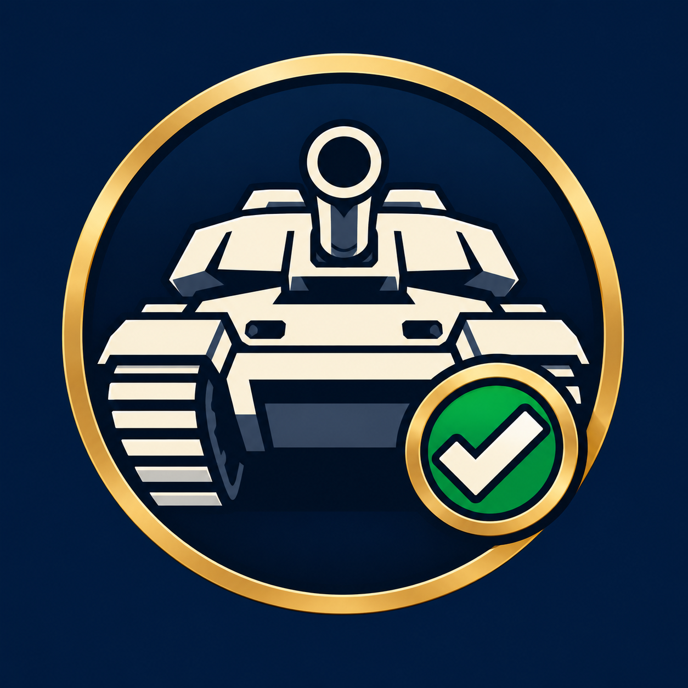

# WoT Verify



Bot Discord indépendant de Battle-Conquest : vérification d'un compte World of Tanks PC EU, attribution du rôle existant **joueur** et synchronisation du pseudo. Interface disponible en anglais et en français, configurable avec `LOCALE=en` (par défaut) ou `LOCALE=fr`. Les messages sont centralisés dans `wot_verify/locales/`.

Le [logo du bot](assets/branding/wot-verify-avatar.png) est prêt à être importé comme avatar Discord. Voir les [instructions d’installation du logo](assets/branding/README.md).

## Fonctionnement

Un administrateur poste le panneau avec `/setup` dans **#verification**. Le bouton persistant répond en privé avec un lien valable dix minutes. Le joueur s'authentifie chez Wargaming ; le serveur vérifie son assertion OpenID 2.0 par `check_authentication` auprès de Wargaming et récupère le pseudo avec l’API publique `account/info`. Les identifiants et pseudos fournis directement dans l'URL de retour ne sont jamais utilisés comme preuve.

Les liaisons sont uniques dans les deux sens et persistées en SQLite. Une nouvelle liaison nécessite `/unlink` puis une vérification. Aucun token Wargaming n’est demandé ni conservé. Le rôle peut être attribué même si Discord refuse ensuite le renommage ; la liaison est conservée et `/resync` permet de réessayer après correction des permissions.

Après confirmation de l’attribution du rôle joueur, le bot publie aussi un message dans le salon du panneau enregistré (ou le salon d’origine du bouton si aucun panneau n’est enregistré). Le message mentionne uniquement le joueur, affiche le rôle sans notifier tous ses membres et reste traduit selon `LOCALE`. Il est envoyé une seule fois par liaison, même après redémarrage ou nouvelle tentative ; une déliaison permet une nouvelle confirmation à la prochaine vérification. Si seul le renommage échoue, le rôle est confirmé et le message propose `/resync`. Un refus d’attribution du rôle ne produit aucune confirmation de réussite. Une panne d’envoi au salon n’annule pas la vérification : l’envoi reste en attente et sera retenté lors d’une synchronisation suivante. Les anciennes liaisons ne génèrent pas de messages rétroactifs sans nouvelle vérification depuis le panneau.

La prise du rôle de contact de clan publie également une confirmation dans ce salon, avec le tag du clan et une mention du joueur uniquement. Une confirmation est envoyée par réservation de contact ; un retrait puis une nouvelle attribution permet un nouveau message. Les échecs d’attribution ou une place déjà occupée n’annoncent aucun succès. L’état est conservé après redémarrage, et un échec d’envoi peut être retenté avec le bouton ou `/resync` tant que le rôle et la réservation sont valides.

Les pages de retour proposent **Return to Discord**, qui ouvre le salon du bouton d'origine. Le salon est inclus dans l'état signé ; aucun token WG n'est transmis à Discord. Les anciens liens encore valides reviennent au serveur. En cas de renommage interdit, la page confirme la liaison et le rôle attribué, puis explique que le membre peut conserver son pseudo sans modifier la hiérarchie du serveur.

| Commande | Accès | Effet |
| --- | --- | --- |
| `/status` | Membre | Affiche en privé son compte lié, son clan actuel et l’état des rôles et du pseudo, sans modification. |
| `/diagnose` | Administrateur | Vérifie en privé les rôles configurés, la hiérarchie et les permissions du bot et du salon. |
| `/setup` | Administrateur | Poste le panneau dans le salon courant. |
| `/resync` | Membre | Actualise rôle et pseudo ; une demande par minute. |
| `/unlink confirm:True` | Membre | Retire le rôle et la liaison ; conserve le pseudo actuel. |
| `/admin_unlink discord_id:…` | Administrateur | Supprime une liaison à partir de l'ID Discord. |
| `/admin_unlink account_id:…` | Administrateur | Supprime une liaison à partir de l'ID WoT. |
| `/admin_contact_remove discord_id:…` | Manage Roles | Retire le contact de clan et libère la place après vérification manuelle. |
| `/contacts page:1` | Manage Roles | Examine cinq contacts de clan par page, en privé et sans retrait automatique. |

Le second bouton **Become a clan contact** vérifie les grades de commandant, commandant en second ou officier de recrutement, attribue un rôle distinct et applique le pseudo `PseudoWG [TAG]`. Un seul contact est autorisé par clan ; un second candidat est orienté vers un modérateur pour vérification manuelle. Activer avec `CLAN_CONTACT_ROLE_ID` dans `.env`, puis publier le panneau avec `/setup`. Voir le [guide des contacts de clan](docs/clan-contacts.md) pour la configuration et les limites.

`/status` consulte uniquement le compte du membre qui lance la commande, avec une limite d’une demande par 30 secondes. Le pseudo enregistré et la date de dernière synchronisation sont distingués des informations Wargaming actuelles. Une panne Wargaming est indiquée comme une information indisponible, jamais comme une absence de clan. Les écarts proposent `/resync` ou une revue par un modérateur ; aucune correction n’est automatique.

`/diagnose` est réservé aux administrateurs, avec contrôle à l’exécution. Il vérifie les permissions **Manage Roles** et **Manage Nicknames**, les rôles joueur/contact (existence, sécurité, hiérarchie) et les permissions **Read Message History**, **View Channel** / **Send Messages** du salon courant (ou **Send Messages in Threads** dans un fil). Le rôle contact désactivé est signalé comme facultatif. Les permissions des autres salons et la position de chaque membre ne sont pas inspectées ; le diagnostic explique les limites de renommage Discord. Aucun secret ni lien de connexion n’est affiché. Après déploiement, les deux nouvelles commandes sont synchronisées automatiquement au démarrage ; aucune nouvelle variable ou migration n’est nécessaire.

Les identifiants des commandes administrateur sont saisis en texte pour éviter les arrondis sur les grands IDs Discord. Donner exactement l'un des deux paramètres. Les permissions sont vérifiées à l'exécution, en plus des restrictions d'affichage des commandes. Un administrateur peut libérer une liaison même après le départ ou le bannissement du membre. Si le membre est présent et que le retrait du rôle échoue, la liaison est conservée pour permettre une nouvelle tentative.

Un contrôle quotidien actualise les liaisons dont la dernière synchronisation réussie remonte à 30 jours ; les échecs sont retentés au contrôle suivant. Discord supprime les rôles d'un membre qui quitte le serveur : à son retour, le bot restaure le rôle et lui demande `/resync` par message privé. Si les MP sont fermés, la commande reste disponible dans le serveur. Les liaisons des membres absents sont conservées jusqu'à suppression explicite.

## Installation / déploiement Unraid et SWAG

### 1. Créer les applications et le salon

1. Dans le [portail développeur Discord](https://discord.com/developers/applications), créer une application **WoT Verify** et son bot. Dans **Bot**, activer **Server Members Intent** ; ne pas activer Message Content. Copier le token directement dans le fichier `.env` du serveur, jamais dans GitHub ou un message.
2. Dans **Installation / OAuth2 URL Generator**, choisir **Guild Install**, les scopes `bot` et `applications.commands`, et les permissions **View Channels**, **Send Messages**, **Read Message History**, **Manage Roles**, **Manage Nicknames**. Inviter le bot sur le serveur cible. Ne pas lui donner Administrator.
3. Placer le rôle du bot au-dessus du rôle **joueur** et de tous les rôles des membres à renommer. Discord interdit de renommer le propriétaire du serveur et les membres au-dessus du bot. Le rôle joueur ne doit être ni géré par une intégration, ni `@everyone`, ni administrateur.
4. Activer le mode développeur Discord ; copier l'ID du serveur et l'ID du rôle existant **joueur** dans `GUILD_ID` et `ROLE_ID`.
5. Créer le salon texte **#verification**, visible par les membres à vérifier. Autoriser le bot à y voir le salon et envoyer des messages. Vérifier les surcharges de permissions du salon. Exécuter `/setup` après le démarrage du bot.
6. Dans [Wargaming Developer Room](https://developers.wargaming.net/applications/), créer une application serveur pour World of Tanks EU. Copier son `application_id` dans `WG_APP_ID`. L’application API sert uniquement à lire les pseudos publics ; la connexion OpenID directe ne requiert pas de redirect URI dans cette application. Le callback reste `https://discord-auth.battle-conquest.eu/callback`, lié à `PUBLIC_URL`.

### 2. Domaine, réseau et configuration

1. Faire pointer `discord-auth.battle-conquest.eu` vers le serveur SWAG et inclure ce sous-domaine dans son certificat TLS. Les ports publics 80/443 arrivent sur SWAG ; ne pas exposer 8080 sur Internet.
2. Utiliser un réseau Docker personnalisé commun à SWAG et au bot. Par exemple, s'il n'existe pas déjà :

   ```bash
   docker network create swag
   docker network connect swag swag
   ```

   Le second `swag` désigne ici le nom du conteneur SWAG : l'adapter. Sur Unraid, rendre cette connexion persistante dans le modèle du conteneur SWAG. Si le réseau porte un autre nom, définir `SWAG_NETWORK` dans `.env`.

3. Installer le dépôt sur un stockage persistant Unraid :

   ```bash
   cd /mnt/user/appdata
   git clone https://github.com/Rayman223/discord-wot-verify.git
   cd discord-wot-verify
   cp .env.example .env
   chmod 600 .env
   openssl rand -hex 32
   mkdir -p data
   chown 1000:1000 data
   chmod 700 data
   ```

4. Renseigner `.env` : `DISCORD_TOKEN`, `WG_APP_ID`, `STATE_SECRET` avec le secret généré, `GUILD_ID`, `ROLE_ID`. Conserver `PUBLIC_URL=https://discord-auth.battle-conquest.eu`, `WG_REGION=eu`, `DATABASE_PATH=/data/verify.sqlite3`, `PORT=8080`. Ne jamais publier ce fichier. Une rotation de `STATE_SECRET` invalide les liens de vérification en cours, sans supprimer les liaisons.
5. Copier `deploy/discord-auth.subdomain.conf` dans `/config/nginx/proxy-confs/` du conteneur SWAG (chemin hôte selon ton installation), puis vérifier et recharger :

   ```bash
   docker exec swag nginx -t
   docker exec swag nginx -s reload
   ```

   Le fichier fourni désactive les logs HTTP sur ce vhost : le callback contient une assertion OpenID et un état temporaire. Ne pas ajouter de journalisation des URL complètes via un proxy, WAF ou service externe en amont. Les logs applicatifs ne contiennent ni tokens ni URL de callback.

### Langue de l’interface

Ajouter `LOCALE=fr` au fichier `.env` pour utiliser le français, ou `LOCALE=en` pour l’anglais (valeur par défaut). La langue s’applique à toute l’instance : messages privés, boutons, descriptions des commandes et pages de retour. Les noms des commandes et leurs paramètres restent identiques, ainsi que les pseudos Wargaming et les tags de clan. Une valeur non prise en charge bloque le démarrage avec une erreur explicite.

Après modification, recréer le conteneur avec `bash /mnt/user/appdata/discord-wot-verify/scripts/update-unraid.sh`. Les descriptions des commandes sont synchronisées au démarrage. Lancer `/setup` dans le salon du panneau enregistré pour actualiser son texte et ses boutons. Lors du premier déploiement de la fonction de suivi du panneau, supprimer une fois l’ancien message non enregistré avant `/setup`. Tester les boutons, `/resync` et une page de retour de vérification.

### 3. Démarrer et vérifier

```bash
docker compose config --quiet
docker compose up -d --build
docker compose logs --tail=50 wot-verify
curl --fail https://discord-auth.battle-conquest.eu/healthz
```

Le contrôle HTTP doit répondre `{"ready": true}` une fois Discord connecté. `/setup` crée le message du bouton. Tester avec un membre ordinaire situé sous le bot : vérification, rôle joueur, pseudo exact, `/resync`, `/unlink`, nouvelle liaison. Redémarrer le conteneur et vérifier que le bouton initial et les liaisons fonctionnent toujours. La [recette complète est dans l'issue #1](https://github.com/Rayman223/discord-wot-verify/issues/1).

#### Sans Docker Compose

Après préparation du `.env`, du répertoire `data` et de SWAG, utiliser directement Docker sur Unraid :

```bash
cd /mnt/user/appdata/discord-wot-verify
docker build -t discord-wot-verify:local .
docker run -d \
  --name wot-verify \
  --restart unless-stopped \
  --network swagproxy \
  --env-file /mnt/user/appdata/discord-wot-verify/.env \
  --mount type=bind,src=/mnt/user/appdata/discord-wot-verify/data,dst=/data \
  --read-only --tmpfs /tmp --cap-drop ALL \
  --security-opt no-new-privileges:true \
  discord-wot-verify:local
docker logs --tail=50 wot-verify
curl --fail https://discord-auth.battle-conquest.eu/healthz
```

Adapter `swagproxy` si le réseau partagé avec SWAG porte un autre nom. Pour les mises à jour suivantes, utiliser `bash /mnt/user/appdata/discord-wot-verify/scripts/update-unraid.sh` : construction avant arrêt, sauvegarde SQLite et tentative de restauration si le nouveau bot ne démarre pas. Le [guide de mise à jour Unraid](docs/unraid-update.md#déclenchement-avec-unraid-user-scripts) fournit le lanceur à copier dans **User Scripts**, indépendant du répertoire courant. Ne pas supprimer le répertoire `data` : le montage conserve les liaisons lors du remplacement du conteneur. Nginx et les variables d'environnement existantes ne nécessitent aucune modification pour le bouton de retour.

Les migrations SQL versionnées dans `wot_verify/migrations/` s'appliquent automatiquement au démarrage et sont suivies dans la table `migrations`. Elles sont idempotentes ; aucun accès à une base Battle-Conquest n'est nécessaire. SQLite exige un stockage local avec verrouillage fiable : éviter un montage SMB/NFS pour `data`.

Pour sauvegarder de façon cohérente, arrêter le bot, copier tout le répertoire `data` puis le redémarrer. Sauvegarder aussi `.env` dans un emplacement privé. Une perte de SQLite impose une nouvelle vérification aux membres ; une sauvegarde contient des identifiants personnels et doit rester privée.

```bash
docker compose stop wot-verify
# Sauvegarder data et .env avec l'outil de sauvegarde Unraid.
docker compose start wot-verify
```

### Limites et exploitation

- Une seule instance du bot et un seul serveur par déploiement ; ne pas lancer plusieurs réplicas sur la même base.
- EU est la configuration initiale. Le client API accepte aussi `com` et `asia`, mais leurs comptes réels restent à valider. La région fait partie de l'identité stockée ; ne pas changer `WG_REGION` sur une base peuplée sans supprimer les liaisons ou migrer explicitement les données. Pour un autre serveur/région, utiliser une instance et une base distinctes.
- Le refus de renommage Discord est indépendant de la validité du pseudo WoT. Vérifier les permissions et la hiérarchie, puis `/resync`. Les erreurs transitoires n'arrêtent pas les synchronisations suivantes.
- Le rôle joueur représente une liaison vérifiée ; retirer uniquement le rôle manuellement ne supprime pas la liaison et le rôle pourra revenir au prochain `/resync`. Utiliser `/admin_unlink` pour révoquer durablement la liaison.
- L'application n'effectue pas de détection des bannissements WoT ; l'administrateur décide quand libérer une liaison.
- Pour ajouter une langue, créer son catalogue dans `wot_verify/locales/` et l’ajouter à `SUPPORTED_LOCALES` dans `wot_verify/i18n.py`. Les clés absentes utilisent le texte anglais.

## Outils de modération et nouvelle tentative web

`/setup` actualise le panneau enregistré après redémarrage ou changement de langue. Depuis un autre salon, la commande indique où se trouve le panneau existant. Pour le déplacer, supprimer l’ancien message puis relancer `/setup` dans le nouveau salon. Un panneau inaccessible produit une erreur sans duplication ; accorder **Read Message History** en plus de l’accès au salon.

`/contacts page:1` est réservé aux membres ayant **Manage Roles**. Il vérifie cinq contacts à la fois : présence Discord, rôles, clan et grade actuels. Une panne Wargaming est signalée comme une information inconnue. Les réservations restent en place jusqu’à une décision manuelle via `/admin_contact_remove`.

Le journal modérateurs est facultatif : définir `LOG_CHANNEL_ID` avec l’identifiant d’un salon texte privé, puis recréer le conteneur. Le bot doit pouvoir y voir le salon et envoyer des messages. Refuser **View Channel** à `@everyone` ; les autorisations explicites de lecture sont limitées aux rôles **Administrator** / **Manage Roles**, à leurs membres ou au bot lui-même. Un salon public ou une permission trop large est refusé sans bloquer les opérations. Les événements utilisent uniquement un type fixe, une date et l’ID Discord concerné : liaison, déliaison, confirmation/retrait de contact et échecs répétés de synchronisation. Les alertes commencent au deuxième échec de synchronisation (commande, retour web ou contrôle périodique) et sont limitées à une par membre et par 24 heures ; une synchronisation réussie remet le compteur à zéro. Les membres ayant quitté le serveur ne déclenchent pas ces alertes et conservent leur liaison. Les cibles de permissions absentes du cache Discord sont vérifiées via l’API ; une erreur de vérification bloque uniquement l’envoi au journal. `LOG_CHANNEL_ID=0` désactive le journal.

Après une vérification partiellement réussie, la page propose **Réessayer la synchronisation**. Cette action POST ne concerne que le compte vérifié dans ce navigateur : cookie sécurisé, jeton CSRF à usage unique, origine contrôlée, expiration dix minutes après la création et trois essais maximum. Un nouvel essai après échec nécessite 30 secondes d’attente. Une déliaison invalide la session, même si le même compte est lié de nouveau. Aucun jeton n’est ajouté à une URL Discord. En fin de session, utiliser `/resync` sur Discord.

Les migrations 005 à 007 s’appliquent automatiquement au démarrage et conservent les liaisons existantes. Après merge, exécuter le [script Unraid habituel](docs/unraid-update.md), puis `/setup` pour enregistrer le panneau (en supprimant auparavant l’ancien message non suivi). Aucun changement SWAG n’est nécessaire : `/resync` utilise le même proxy. Ne pas activer la journalisation des URL de connexion ni des corps de formulaire.

## Développement et contrôles

Python 3.12 :

```bash
python -m venv .venv
.venv/bin/pip install -r requirements.lock
.venv/bin/pip install -e '.[dev]'
.venv/bin/ruff check .
.venv/bin/ruff format --check .
.venv/bin/pytest -q
```

Les tests utilisent exclusivement des bases SQLite temporaires et des doubles Discord/Wargaming. Ils ne touchent aucun serveur Discord ni base de production. Le fichier `requirements.lock` fixe les dépendances d'exécution utilisées par Docker ; les outils de développement sont déclarés séparément. Le workflow QA se lance à l'ouverture/mise à jour de PR ou manuellement ; ses résultats sont vérifiés manuellement.

Détails du protocole, des protections et de la migration : [connexion OpenID](docs/openid.md).

Références : [OpenID 2.0](https://openid.net/specs/openid-authentication-2_0.html), [discord.py et permissions des commandes](https://discordpy.readthedocs.io/en/stable/interactions/api.html).

Licence MIT.
