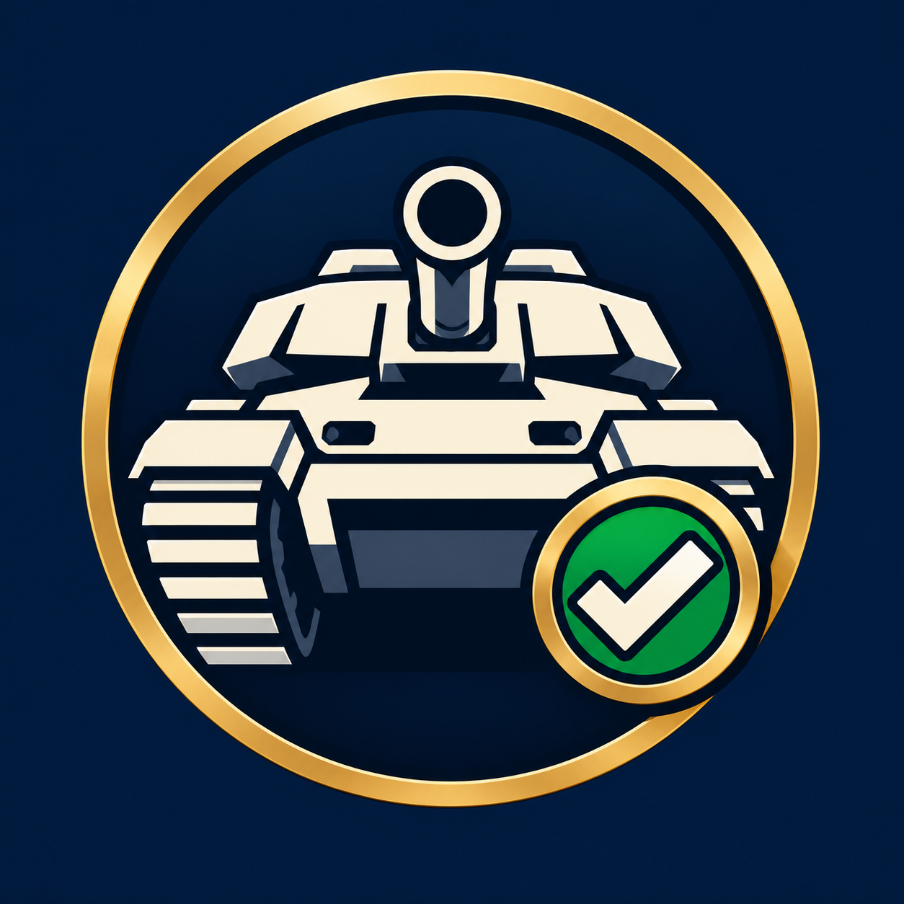

# WoT Verify



A Discord bot independent of Battle-Conquest: verify a World of Tanks PC EU account, assign the existing **player** role and synchronize the member's nickname. The interface supports English and French through `LOCALE=en` (default) or `LOCALE=fr`. Messages are centralized in `wot_verify/locales/`.

The [bot logo](assets/branding/wot-verify-avatar.png) is ready to upload as a Discord avatar. See the [logo installation instructions](assets/branding/README.md) (French). The linked deployment and protocol guides remain in French.

## How it works

An administrator posts the persistent panel in **#verification** with `/setup`. Its button privately returns a login link valid for ten minutes. The player authenticates with Wargaming; the server checks the OpenID 2.0 assertion with Wargaming's `check_authentication` and retrieves the nickname through the public `account/info` API. Account IDs and nicknames supplied directly in the callback URL are never accepted as proof.

Links are unique in both directions and stored in SQLite. Changing a link requires `/unlink` followed by verification. No Wargaming access token is requested or stored. The player role can be assigned even if Discord subsequently refuses the nickname change; the link is retained and `/resync` retries after permissions have been fixed.

### Player and visitor roles

When `VISITOR_ROLE_ID` is configured, assigning the **player** role removes the **visitor** role. Removing **player** restores **visitor**, including `/unlink`, `/admin_unlink` and manual Discord role changes. Verification, `/resync` and the return of a linked player also apply this switch. Other roles are preserved. Removing only the clan contact role does not make the member a visitor.

For the original server, add `VISITOR_ROLE_ID=475356542716084238` to `.env`, or use `0` to disable the feature. The visitor role must be different from the player and clan contact roles, must not have Administrator permissions and must be below the bot's highest role. After changing configuration, recreate the container with the normal update script. `/diagnose` checks this role too. Existing players can use `/resync` to remove a leftover visitor role; the periodic check also applies the switch at the next synchronization.

If Discord rejects the switch, commands report the failure and retain the link for another attempt. Failed manual role changes are recorded in the bot logs. After fixing permissions, assign and remove the player role again, or retry unlinking. Absent members cannot receive roles remotely.

### Public confirmations and returning to Discord

Once the player role has been confirmed, the bot posts a confirmation in the saved panel's channel, or in the button's original channel if no panel is saved. It mentions only the player and displays the role name as plain text, without mentioning the role. Messages follow `LOCALE` and are automatically deleted after 30 seconds.

One player confirmation is sent per link, including across restarts and retries. Unlinking allows a new confirmation on the next verification. If only renaming fails, the confirmation explains that `/resync` can retry it. A failed role assignment never produces a success message. Failure to send to the channel does not undo verification: delivery remains pending and is retried during a later synchronization. Old links do not generate retroactive confirmations without a new panel verification.

Claiming the clan contact role also posts a confirmation in this channel, with the clan tag, a plain-text role name and only a player mention. One message is sent per reservation; removing and reclaiming it allows another. Role assignment failures and occupied clan slots never announce success. State survives restarts, and failed delivery can be retried with the button or `/resync` while the role and reservation remain valid.

Command and button replies remain private. The bot schedules deletion of public confirmations: stopping the container during those 30 seconds, or Discord denying deletion, can leave a message visible.

Callback pages offer **Return to Discord**, opening the original button's channel. The channel is included in the signed state; no Wargaming token is passed to Discord. Older valid links return to the server. If renaming is forbidden, the page confirms the link and role and explains that the member can keep their nickname without changing the server hierarchy.

## Commands

| Command | Access | Effect |
| --- | --- | --- |
| `/status` | Member | Privately shows the member's linked account, current clan, roles and nickname state without making changes. |
| `/diagnose` | Administrator | Privately checks configured roles, hierarchy and bot/channel permissions. |
| `/stats` | Administrator | Shows database figures, then completes the private report with live Discord/Wargaming checks. |
| `/admin_import_players` | Administrator | Previews importing existing player and clan contact roles without changing anything. |
| `/admin_import_players confirm:True` | Administrator | Rechecks and imports eligible identities and clan reservations, then removes leftover visitor roles. |
| `/setup` | Administrator | Posts or updates the verification panel in the current channel. |
| `/resync` | Member | Refreshes roles and nickname; one request per minute. |
| `/unlink confirm:True` | Member | Removes the roles and link; clan contact suffix cleanup follows the rules below. |
| `/admin_unlink discord_id:…` | Administrator | Removes a link by Discord ID. |
| `/admin_unlink account_id:…` | Administrator | Removes a link by WoT account ID. |
| `/admin_contact_remove discord_id:…` | Manage Roles | Removes a clan contact and frees the slot after manual review. |
| `/contacts page:1` | Manage Roles | Privately reviews five clan contacts per page without automatic removal. |

Administrator IDs are entered as text to avoid rounding large Discord IDs. Give exactly one target parameter to `/admin_unlink`. Permissions are checked at execution as well as through command visibility restrictions. An administrator can release a link after a member has left or been banned. If a present member's role cannot be removed, the link is retained for a retry.

`/status` only inspects the invoking member's account, with one request per 30 seconds. Stored nicknames and the last successful synchronization are distinguished from current Wargaming data. A Wargaming outage means unavailable information, never “no clan.” Discrepancies suggest `/resync` or moderator review; no correction is automatic.

`/diagnose` checks **Manage Roles**, **Manage Nicknames**, the player/contact/visitor roles (existence, safety and hierarchy), and **Read Message History**, **View Channel** and **Send Messages** in the current channel, or **Send Messages in Threads** in a thread. Disabled optional roles are reported as such. It does not inspect every channel's permissions or every member's hierarchy; it explains Discord's nickname restrictions. No secrets or login links are displayed. Commands synchronize automatically at startup.

A daily check refreshes links whose last successful synchronization was at least 30 days ago, including links never successfully synchronized. Failures are retried at the next check. Discord removes roles when a member leaves; on return, the bot restores the player role and requests `/resync` by DM. If DMs are closed, the command is still available in the server. Links for absent members remain until explicitly deleted.

### Clan contacts

The second panel button, **Become a clan contact**, checks for commander, executive officer or recruitment officer rank, assigns a separate role and uses the nickname `WargamingNickname [TAG]`. Only one contact is allowed per clan. A second candidate is referred to a moderator for manual verification; no existing reservation is replaced. Enable it with `CLAN_CONTACT_ROLE_ID` in `.env`, then publish the panel with `/setup`. See the [clan contacts guide](docs/clan-contacts.md) for configuration and limitations.

### Statistics and importing existing players

`/stats` displays local figures directly in a private Discord embed, then updates the report after inspecting Discord and Wargaming. Use the arrow buttons to browse all figures and the list of players with anomalies; no file download is required. Each anomaly row shows the Discord server nickname, WoT nickname when known, both IDs and the problems found. A stored WoT nickname is labelled as stored when no current nickname was obtained. Members with only matching identities or successful import/role cleanup results are omitted from this detail list; their totals remain in the summary. Progress is updated every ten seconds with the current phase, coverage and imported players. Local values describe the snapshot at the start of the operation, not a lifetime event history.

The report includes:

- **Players and clans:** linked players, clan contacts, represented clans and linked players with or without a contact reservation.
- **Synchronization:** never synchronized, synchronized within 30 days, due for periodic synchronization, and the oldest/latest successful synchronization in UTC. “Due” includes never-synchronized links.
- **Failures:** members with unresolved or repeated failures, sum/maximum of retained counters, and members with an alert recorded within 24 hours. Recording an alert is not proof of delivery.
- **Confirmations:** retained player/contact messages delivered or pending, separately. These are retained records, not lifetime totals.
- **Web verification:** valid/expired challenges, unexpired/expired retry sessions, usable/waiting/exhausted retries, and retained OpenID nonces. Exhausted sessions are counted separately within unexpired sessions.
- **Technical state:** saved panels, tracked tags and affected members, potential tag cleanup without a reservation, orphan contact reservations, applied migrations and logical SQLite size excluding WAL/SHM files.
- **Live consistency:** linked players present/absent, player/visitor/contact role holders, player roles without links, linked members without player roles, combined player/visitor roles, contacts without player roles, reservations without contact roles and the reverse, changed clans, ineligible ranks, incorrect/missing tags and nickname discrepancies. Unlinked player roles are checked for exact WoT matches and classified as importable, desynchronized or unknown/conflicting.

There is no regional breakdown: the intended deployment is EU. Historical trends, daily signups, unlink counts, success rates and verification durations are not recorded by this feature. Existing identities from another configured region are reported as unavailable rather than queried against the wrong API.

`/admin_import_players` previews existing human members with the player role. It uses their server nickname, or their Discord display name if no server nickname is set, and looks for an exact EU WoT account match (case insensitive, without approximate matching). A trailing `[TAG]` is accepted only when Wargaming confirms that clan tag. No match is reported as **desynchronized**; API errors remain **unknown**. A contact role without the player role is reported but does not grant or import a player role.

Review the report pages, then run `/admin_import_players confirm:True` to repeat the checks and apply valid matches. This is an administrative import based on existing roles and names, **not individual OpenID authentication**. Only administrators should run it after reviewing the server's existing role assignments.

The import:

- Creates missing links without replacing existing links or assigning a WoT account already owned by another member. Duplicate candidates for an unclaimed account are all skipped.
- Imports a clan contact reservation only when the member has both roles, the tag matches, the rank is authorized and the clan slot is free. Duplicate candidates for a free clan slot are skipped. A contact conflict does not prevent an independently valid player link.
- Rechecks identity, roles and database state before writing. A changed member is skipped. Existing reservations are never silently transferred.
- Removes a leftover visitor role for a matching player. A failed removal is reported separately and leaves the valid link in place for a retry.
- Does not rename members, remove player/contact roles, create a “desynchronized” role or post public verification confirmations. Imported links remain never-synchronized until normal `/resync` or the periodic check completes.

Both commands share a single running-operation guard per server and a 60-second interval between starts. The scan uses exact-name searches and account/clan reads in batches of at most 100, rather than querying each player separately. Before applying an import, each batch fetches members and fresh WG data again; every write still rechecks the member and database under the bot lock. WG snapshots are discarded between phases and invocations. Duplicate conflicts are resolved across the entire scan, including different batches. Missing or malformed batch entries remain unknown and are never imported as confirmed matches. All public Wargaming API calls from this bot process share a limit of two concurrent calls and two starts per second, including verification, other commands and periodic synchronization. Rate-limit responses trigger a shared pause and at most two retries; other API errors remain unavailable information. Other processes using the same application ID do not share this in-memory limiter. An operation stops after ten minutes and explicitly reports partial coverage in the message. If the scan consumes this deadline, import application does not start. For 638 unlinked players with valid, distinct WoT names, the scan needs 14 WG requests (seven searches and seven clan reads), plus another 14 to revalidate an import; missing matches can reduce this count, while mixed linked/unlinked populations or retries can increase it. Duration also depends on Discord and WG response times. A failed final message edit triggers a new private reply with the report. Operation starts, progress, completion, timeouts and API/delivery errors are logged without credentials or external response bodies. Missing API information is not counted as an absent account/clan. An incomplete Discord enumeration never establishes absence and prevents application of that import scan. If application itself is interrupted, already completed imports remain; rerunning is idempotent. Counts of observed roles are partial when Discord enumeration is incomplete.

These features use the existing schema and configuration. No new migration or environment variable is needed. After deployment, let command synchronization finish at startup, run `/stats`, inspect an import preview, then apply only the reviewed eligible players.

## Installation / deployment with Unraid and SWAG

### 1. Create the applications and channel

1. In the [Discord Developer Portal](https://discord.com/developers/applications), create a **WoT Verify** application and bot. Under **Bot**, enable **Server Members Intent**; leave Message Content disabled. Copy the token directly into the server's `.env`, never into GitHub or a message.
2. Under **Installation / OAuth2 URL Generator**, choose **Guild Install**, the `bot` and `applications.commands` scopes, and **View Channels**, **Send Messages**, **Read Message History**, **Manage Roles**, **Manage Nicknames** permissions. Invite the bot to the target server. Do not grant Administrator.
3. Place the bot's highest role above the existing **player** role and every member it must rename. Discord prevents renaming the server owner and members above the bot. The player role must not be integration-managed, `@everyone` or Administrator.
4. Enable Discord Developer Mode; copy the server ID and the existing **player** role ID into `GUILD_ID` and `ROLE_ID`.
5. Create a **#verification** text channel visible to members who need verification. Allow the bot to view and send in it, including channel permission overrides. Run `/setup` after startup.
6. In [Wargaming Developer Room](https://developers.wargaming.net/applications/), create a server application for World of Tanks EU. Copy its `application_id` into `WG_APP_ID`. The API application reads public nicknames and clan information. Direct OpenID login requires no redirect URI in that application. The callback remains `https://discord-auth.battle-conquest.eu/callback`, derived from `PUBLIC_URL`.

### 2. Domain, networking and configuration

1. Point `discord-auth.battle-conquest.eu` to the SWAG server and include this subdomain in its TLS certificate. Public ports 80/443 go to SWAG; do not expose 8080 to the Internet.
2. Use a custom Docker network shared by SWAG and the bot. For example, if it does not exist:

   ```bash
   docker network create swag
   docker network connect swag swag
   ```

   The second `swag` is the SWAG container name: adjust it. On Unraid, make the connection persistent in the SWAG container template. If the network has another name, set `SWAG_NETWORK` in `.env`.

3. Install the repository on persistent Unraid storage:

   ```bash
   cd /mnt/user/appdata
   git clone https://github.com/Rayman223/discord-wot-verify.git
   cd discord-wot-verify
   cp .env.example .env
   chmod 600 .env
   openssl rand -hex 32
   mkdir -p data
   chown 1000:1000 data
   chmod 700 data
   ```

4. Fill in `.env`: `DISCORD_TOKEN`, `WG_APP_ID`, `STATE_SECRET` using the generated secret, `GUILD_ID` and `ROLE_ID`. Keep `PUBLIC_URL=https://discord-auth.battle-conquest.eu`, `WG_REGION=eu`, `DATABASE_PATH=/data/verify.sqlite3`, `PORT=8080`. Never publish this file. Rotating `STATE_SECRET` invalidates pending verification links without deleting account links.
5. Copy `deploy/discord-auth.subdomain.conf` into `/config/nginx/proxy-confs/` inside SWAG (host path depends on your installation), then validate and reload:

   ```bash
   docker exec swag nginx -t
   docker exec swag nginx -s reload
   ```

   The supplied configuration disables HTTP logs for this vhost: callbacks contain an OpenID assertion and temporary state. Do not add full-URL logging through an upstream proxy, WAF or external service. Application logs contain neither tokens nor callback URLs.

### Interface language

Set `LOCALE=fr` in `.env` for French, or `LOCALE=en` for English (default). The language applies to the entire instance: private messages, buttons, command descriptions and callback pages. Command names/parameters, Wargaming nicknames and clan tags do not change. An unsupported value stops startup with an explicit error.

After a change, recreate the container with `bash /mnt/user/appdata/discord-wot-verify/scripts/update-unraid.sh`. Command descriptions synchronize at startup. Run `/setup` in the saved panel channel to refresh its text and buttons. When first deploying panel tracking, delete the old untracked message once before `/setup`. Test the buttons, `/resync` and a verification callback page.

### 3. Start and verify

```bash
docker compose config --quiet
docker compose up -d --build
docker compose logs --tail=50 wot-verify
curl --fail https://discord-auth.battle-conquest.eu/healthz
```

The HTTP check should return `{"ready": true}` once Discord is connected. `/setup` creates the panel. Test with an ordinary member below the bot: verification, player role, exact nickname, `/resync`, `/unlink`, and verification again. Restart the container and confirm the original button and stored links still work. See the [full acceptance checklist in issue #1](https://github.com/Rayman223/discord-wot-verify/issues/1).

#### Without Docker Compose

After preparing `.env`, `data` and SWAG, run Docker directly on Unraid:

```bash
cd /mnt/user/appdata/discord-wot-verify
docker build -t discord-wot-verify:local .
docker run -d \
  --name wot-verify \
  --restart unless-stopped \
  --network swagproxy \
  --env-file /mnt/user/appdata/discord-wot-verify/.env \
  -v /mnt/user/appdata/discord-wot-verify/data:/data:rw \
  --read-only --tmpfs /tmp --cap-drop ALL \
  --security-opt no-new-privileges:true \
  discord-wot-verify:local
docker logs --tail=50 wot-verify
curl --fail https://discord-auth.battle-conquest.eu/healthz
```

Adjust `swagproxy` to the network shared with SWAG. For later updates, use `bash /mnt/user/appdata/discord-wot-verify/scripts/update-unraid.sh`: it builds before stopping, backs up SQLite and attempts rollback if the new bot fails to start. The [Unraid update guide](docs/unraid-update.md#déclenchement-avec-unraid-user-scripts) provides a **User Scripts** launcher independent of the current directory. Never delete `data`: its mount preserves links when replacing the container. The return-to-Discord button needs no Nginx or environment changes.

Versioned SQL migrations in `wot_verify/migrations/` run automatically at startup and are tracked in `migrations`. They are idempotent; no Battle-Conquest database access is needed. SQLite requires local storage with reliable locking: avoid SMB/NFS mounts for `data`.

For consistent backups, stop the bot, copy the entire `data` directory, then restart it. Also back up `.env` privately. Losing SQLite requires members to verify again; backups contain personal identifiers and must remain private.

With **Appdata Backup**, the `-v` mount lets Unraid detect `data`. The container name can differ from the folder name. Because `.env` is outside the mount, add it to the additional files to back up. See the [Appdata Backup configuration and repair instructions for older deployments](docs/unraid-update.md#sauvegardes-avec-appdata-backup).

```bash
docker compose stop wot-verify
# Back up data and .env with your Unraid backup tool.
docker compose start wot-verify
```

### Limitations and operation

- Deploy one bot instance for one server. Never run multiple replicas against the same database.
- EU is the initial configuration. The API client also accepts `com` and `asia`, but their real accounts still need validation. Region is part of stored identity: do not change `WG_REGION` on a populated database without deleting links or explicitly migrating data. Use separate instances/databases for other servers or regions.
- Discord's nickname refusal is independent of WoT nickname validity. Check permissions and hierarchy, then use `/resync`. Transient errors do not stop later synchronizations.
- The player role represents a linked identity. Manually removing only that role does not delete the link, so it can return on the next `/resync`. Use `/admin_unlink` for permanent revocation.
- The application does not detect WoT bans. An administrator decides when to release a link.
- To add a language, create its catalogue in `wot_verify/locales/` and add it to `SUPPORTED_LOCALES` in `wot_verify/i18n.py`. Missing keys fall back to English.

## Moderation tools and web retry

`/setup` refreshes the saved panel after a restart or language change. From another channel, it reports where the existing panel is located. To move it, delete the old message and run `/setup` in the new channel. An inaccessible panel produces an error without duplication; grant **Read Message History** as well as channel access.

`/contacts page:1` requires **Manage Roles**. It checks five contacts at a time for Discord presence, roles, current clan and rank. Wargaming outages are reported as unknown information. Reservations remain until a manual decision through `/admin_contact_remove`.

The moderator journal is optional: set `LOG_CHANNEL_ID` to a private text channel ID and recreate the container. The bot must be able to view and send in that channel. Deny **View Channel** to `@everyone`; explicit read grants must be limited to **Administrator** / **Manage Roles** roles, their members or the bot itself. A public channel or overly broad grant is rejected without blocking operations.

Journal events contain only a fixed event type, timestamp and relevant Discord ID: link, unlink, contact confirmation/removal and repeated synchronization failures. Alerts start at the second synchronization failure (command, callback or periodic check) and are limited to one per member per 24 hours. A successful synchronization clears the counter. Departed members do not trigger these alerts and keep their links. Permission targets missing from Discord's cache are checked through the API; failure to verify them blocks only journal delivery. `LOG_CHANNEL_ID=0` disables the journal.

After partially successful verification, the callback page offers **Retry synchronization**. This POST action concerns only the account verified in that browser: secure cookie, single-use CSRF token, validated origin, expiration ten minutes after creation and at most three attempts. After a failure, wait 30 seconds before retrying. Unlinking invalidates the session even if the same account is subsequently linked again. No token is added to a Discord URL. After the session ends, use `/resync` in Discord.

Migrations 005–007 run automatically at startup and preserve existing links. After deployment, run the [normal Unraid update script](docs/unraid-update.md), then `/setup` to record the panel, first deleting an old untracked panel if needed. No SWAG changes are required: `/resync` uses the same proxy. Never enable logging of login URLs or form bodies.

## Development and checks

Python 3.12:

```bash
python -m venv .venv
.venv/bin/pip install -r requirements.lock
.venv/bin/pip install -e '.[dev]'
.venv/bin/ruff check .
.venv/bin/ruff format --check .
.venv/bin/pytest -q
```

Tests use temporary SQLite databases and Discord/Wargaming doubles exclusively. They never touch a real Discord server or production database. `requirements.lock` pins Docker runtime dependencies; development tools are declared separately. QA runs when a PR is opened/updated or on manual dispatch; the user checks its results manually.

Protocol, security and migration details: [OpenID login](docs/openid.md).

References: [OpenID 2.0](https://openid.net/specs/openid-authentication-2_0.html), [discord.py command permissions](https://discordpy.readthedocs.io/en/stable/interactions/api.html).

MIT license.
